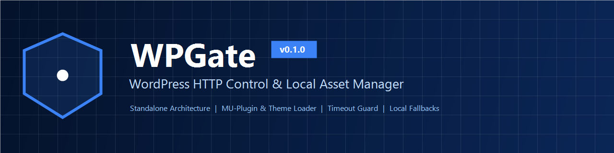

<div align="center">



# ماژول مستقل WPGate

**سامانه پیشرفته کنترل درخواست‌های HTTP و مدیریت محلی دارایی‌های وردپرس**

[English Documentation (README.md)](README.md) | [مستندات فنی (docs/)](docs/architecture.md) | [قوانین مشارکت](CONTRIBUTING.md) | [تاریخچه تغییرات](CHANGELOG.md)

</div>

---

## ۱. معرفی و فلسفه پروژه

پروژه **WPGate** یک ماژول فوق‌سبک، امن، مستقل و منطبق با استانداردهای سطح سازمانی وردپرس (Enterprise-Grade) است که بدون وابستگی به مکانیزم فعال‌سازی افزونه‌ها طراحی شده است.

این ماژول نسخه بازمهندسی‌شده و تکامل‌یافته ایده اولیه افزونه قطعینو (تیم شکرینو) است که تمام باگ‌های پرخطر، کپی‌های ناامن ران‌تایم روی دیسک، نشت پارامترهای حساس و کندی‌های دیتابیس در آن اصلاح شده و در قالب یک هسته استاندارد PHP با دو شیوه استقرار (MU-Plugin و Theme) عرضه گردیده است.

هدف اصلی WPGate این است که وبسایت شما در هنگام قطع یا اختلال اینترنت بین‌الملل (شبکه ملی اطلاعات) یا از دسترس خارج شدن وب‌سرویس‌های خارجی، بدون افت سرعت، بدون معطلی سرور (Timeout) و بدون به هم ریختگی فونت‌ها و ظاهر سایت پایدار بماند.

---

## ۲. مزایای معماری WPGate

- **ماژولار و مستقل از جدول افزونه‌ها:** بدون نیاز به اکتیویشن افزونه؛ قابل لود از طریق `wp-content/mu-plugins` یا فایل `functions.php` قالب.
- **لود زودهنگام (Early Bootstrap):** در حالت Must-Use، پیش از افزونه‌هایی نظیر Elementor، WooCommerce و Rank Math اجرا شده و توانایی فیلتر زودهنگام تمامی درخواست‌ها را دارد.
- **تطبیق هوشمند زیردامنه‌ها:** پشتیبانی از تفکیک ساب‌دامنه‌ها و ممانعت قطعی از جعل پیشوند نام دامنه‌ها (Prefix Spoofing).
- **کلید خاموشی اضطراری (Kill-Switch):** توقف کامل و آنی ماژول از طریق فایل `wp-config.php`:
  ```php
  define( 'WPGATE_CORE_DISABLED', true );
  ```
- **حذف تغییرات دیسک در زمان اجرا:** بدون هیچ‌گونه عملیات `copy` یا نوشتن روی فایل‌سیستم در ران‌تایم؛ سازگاری ۱۰۰٪ با کانتینرهای داکر، کوبرنتیز و هاست‌های Read-Only.
- **پالایش امنیتی لاگ‌ها (Security Redaction):** حذف و سانسور خودکار توکن‌های پرداخت، پسوردها و کلیدهای API قبل از ذخیره در دیتابیس.
- **بازنویسی منابع CDN خارجی:** هدایت هوشمند درخواست فونت‌های گوگل (وزیرمتن و روبوتو)، FontAwesome، Dashicons و Swiper به بسته‌های محلی موجود در ماژول.
- **خنثی‌سازی Mixpanel:** مسدودسازی درخواست‌های سرویس Mixpanel و ارائه آبجکت جاوااسکریپت خنثی در فرانت‌اند جهت ممانعت از خطای کنسول.
- **سقف تایم‌اوت هوشمند:** کاهش زمان انتظار درخواست‌های کند خارجی به حداکثر ۳ ثانیه برای جلوگیری از هنگ کردن پردازش‌های PHP.
- **آپدیت‌های امنیتی باز به صورت پیش‌فرض:** حفظ پیش‌فرض آپدیت‌های امنیتی و هسته وردپرس جهت صیانت از سلامت پایدار سایت.

---

## ۳. شیوه‌های استقرار و نصب

### روش الف: استقرار به صورت Must-Use Plugin (پیشنهادی)

در این شیوه، ماژول در بالاترین اولویت اجرایی وردپرس قرار می‌گیرد.

۱. فایل فشرده [`WPGate-MU-Plugin-v0.1.0.zip`](https://github.com/satinbest/WPGate/releases) را دانلود کنید.
۲. محتوای آرشیو را مستقیماً در پوشه `wp-content/` هاست خود اکسترکت کنید:
   ```text
   wp-content/
   └── mu-plugins/
       ├── wpgate-loader.php
       └── wpgate-core/
           ├── bootstrap.php
           ├── includes/
           ├── config/
           ├── admin/
           └── assets/
   ```
۳. وارد پیشخوان وردپرس شوید؛ منوی **«WPGate»** به زیرمنوی «تنظیمات» اضافه خواهد شد.

---

### روش ب: استقرار از طریق قالب (Theme functions.php)

چنانچه دسترسی مدیریت سرور برای ایجاد پوشه `mu-plugins` را ندارید:

۱. فایل فشرده [`WPGate-Theme-Module-v0.1.0.zip`](https://github.com/satinbest/WPGate/releases) را دانلود کنید.
۲. پوشه `wpgate-core` را در ریشه چایلدتم خود کپی کنید:
   ```text
   wp-content/themes/your-child-theme/wpgate-core/
   ```
۳. قطعه کد زیر را در ابتدای فایل `functions.php` قالب فرزند قرار دهید:
   ```php
   // بارگذاری هسته مستقل WPGate
   if ( file_exists( get_stylesheet_directory() . '/wpgate-core/bootstrap.php' ) ) {
       require_once get_stylesheet_directory() . '/wpgate-core/bootstrap.php';
   }
   ```

> [!NOTE]
> **نکته مهم در رابطه با زمان‌بندی (Timing Difference):**
> در شیوه قالب، اجرای ماژول همزمان با فایل `functions.php` آغاز می‌شود؛ بنابراین درخواست‌های HTTP که حین لود زودهنگام افزونه‌های دیگر ارسال شوند قابل رهگیری توسط این شیوه نیستند. برای حفاظت حداکثری، همواره روش الف توصیه می‌شود.

---

## ۴. راهنمای پیکربندی تنظیمات

در صفحه تنظیمات ماژول چهار بخش کلیدی تعبیه شده است:

1. **فایروال درخواست‌های خارجی:**
   - **غیرفعال:** بدون فیلترینگ و عبور عادی کلیه درخواست‌ها.
   - **لیست سفید (توصیه در شرایط قطعی اینترنت بین‌الملل):** مسدودسازی همه سرورهای خارجی به جز هاست‌های مجاز.
   - **لیست سیاه:** مسدودسازی صرف دامنه‌های تعریف شده در لیست سیاه.
2. **افزودن سریع دامنه‌ها (Quick Presets):**
   تنها با یک کلیک می‌توانید دامنه‌های شاپرک (PSP)، پرداخت‌یارها (زرین‌پال، آیدی‌پی و...)، پرداخت اقساطی (دیجی‌پی، اسنپ‌پی)، پنل‌های پیامکی، شرکت‌های پستی و CDNهای ایرانی را به لیست سفید بیافزایید.
3. **بهینه‌سازی فایل‌های استاتیک:**
   امکان فعال‌سازی بازنویسی فونت‌ها و کتابخانه‌های فرانت‌اند و لود فونت محلی وزیرمتن.
4. **پایداری زمان پاسخ و لاگ‌ها:**
   تنظیم سقف Timeout، قطع تلمتری به `wordpress.org`، جایگزینی گراواتار، و مشاهده تاریخچه رویدادهای پالایش‌شده.

---

## ۵. مهاجرت از نسخه قدیمی قطعینو (Migration)

ماژول WPGate به صورت هوشمند دارای لایه سازگاری معکوس است:
- در صورت وجود تنظیمات در کلید قدیمی `ghateino_http_control_settings`، داده‌ها به صورت خودکار به `wpgate_http_control_settings` منتقل می‌شوند.
- اگر ثابت قدیمی `GHATEINO_CORE_DISABLED` در فایل `wp-config.php` تعریف شده باشد، WPGate آن را معتبر دانسته و خاموش می‌شود.
- فیلترهای برنامه‌نویسی قدیمی نیز همچنان پشتیبانی می‌شوند.

برای مطالعه جزئیات مهاجرت به [docs/migration.md](docs/migration.md) مراجعه فرمایید.

---

## ۶. نحوه حذف ایمن (Uninstallation)

به دلیل ایزوله بودن معماری، حذف ماژول هیچ ریسکی برای هسته دیتابیس ندارد:
- **در حالت MU-Plugin:** حذف فایل `wp-content/mu-plugins/wpgate-loader.php` و پوشه `wp-content/mu-plugins/wpgate-core`.
- **در حالت Theme:** حذف خط لود از `functions.php` و حذف پوشه `wpgate-core`.
- پاک‌سازی گزینه‌های `wpgate_http_control_settings` و `wpgate_http_logs` از جدول `wp_options` به صورت اختیاری.

---

## ۷. ساختار مستندات تکمیلی

- [معماری سیستم و چرخه حیات (docs/architecture.md)](docs/architecture.md)
- [راهنمای جامع قابلیت‌ها (docs/features.md)](docs/features.md)
- [مشخصات کامل تنظیمات (docs/configuration.md)](docs/configuration.md)
- [راهنمای نصب MU-Plugin (docs/installation-mu-plugin.md)](docs/installation-mu-plugin.md)
- [راهنمای نصب در قالب (docs/installation-theme-loader.md)](docs/installation-theme-loader.md)
- [عیب‌یابی و حل مشکلات رایج (docs/troubleshooting.md)](docs/troubleshooting.md)
- [پرسش‌های متداول - FAQ (docs/faq.md)](docs/faq.md)
- [سیاست‌های امنیتی (SECURITY.md)](SECURITY.md)
- [راهنمای انتشار نگارش‌ها (docs/release-process.md)](docs/release-process.md)

---

## ۸. حقوق مالکیت و لایسنس

کد هسته WPGate تحت مجوز **GPLv2 یا بالاتر** منتشر شده است. دارایی‌های جانبی شامل فونت وزیرمتن (OFL 1.1)، فونت‌آسام (SIL OFL/MIT)، سوئیپر (MIT) و دش‌آیکونز تحت مجوزهای متن‌باز مربوط به خود توزیع گردیده‌اند.  
جهت مطالعه جزئیات حقوقی به [LICENSE-NOTICE.md](LICENSE-NOTICE.md) مراجعه فرمایید.
