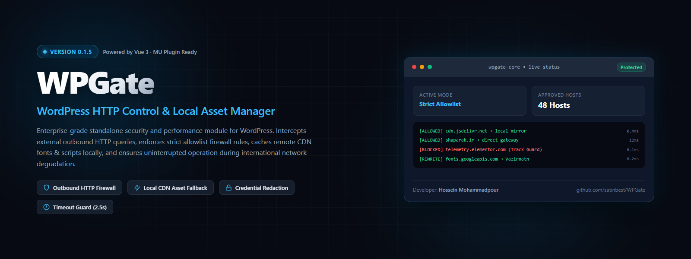

<div align="center">

**[English](README.md) | [فارسی](README-FA.md)**



# WPGate

**Enterprise Outbound HTTP Firewall & Local Asset Gateway for WordPress**

[](https://github.com/satinbest/WPGate/actions/workflows/ci.yml)
[](https://github.com/satinbest/WPGate/releases)
[](https://www.php.net/)
[](https://wordpress.org/)
[](https://vuejs.org/)
[](LICENSE-NOTICE.md)

[📥 Download Latest Release](https://github.com/satinbest/WPGate/releases) | [🇮🇷 مستندات فارسی (README-FA.md)](README-FA.md) | [Admin Interface Guide](docs/en/admin-interface.md) | [Performance Report](PERFORMANCE-REPORT.md) | [Bugfix Report](reports/ADMIN-UI-BUGFIX.md)

</div>

---

## 📥 Downloads & Installation

Ready-to-use production installers are available on our [GitHub Releases](https://github.com/satinbest/WPGate/releases) page:

| Package | Recommended Target | Purpose |
|---|---|---|
| [**`WPGate-MU-Plugin-v0.1.5.zip`**](https://github.com/satinbest/WPGate/releases) | `wp-content/mu-plugins/` | **Recommended:** Early bootstrap, intercepts requests before plugins load |
| [**`WPGate-Theme-Module-v0.1.5.zip`**](https://github.com/satinbest/WPGate/releases) | Active Child Theme | For hosting environments without `mu-plugins` write permissions |
| [**`WPGate-Complete-Release-v0.1.5.zip`**](https://github.com/satinbest/WPGate/releases) | Development / Auditing | Full release archive with source code, tests, and documentation |

### Fresh Installation (MU-Plugin Method)
1. Download `WPGate-MU-Plugin-v0.1.5.zip`.
2. Extract the archive directly into your WordPress `wp-content/mu-plugins/` directory:
   ```text
   wp-content/mu-plugins/
   ├── wpgate-loader.php
   └── wpgate-core/
       ├── bootstrap.php
       ├── includes/
       ├── config/
       ├── admin/
       │   └── dist/
       │       ├── wpgate-admin.js
       │       └── wpgate-admin.css
       └── assets/
   ```
3. Open your WordPress admin dashboard and navigate to **Settings > WPGate**.
4. The Vue 3 dashboard mounts instantly with zero additional setup or activation needed.

### Updating an Existing Installation
1. Back up your existing `wp-content/mu-plugins/wpgate-core/` directory.
2. Download `WPGate-MU-Plugin-v0.1.5.zip`.
3. Extract and overwrite the files inside `wp-content/mu-plugins/`.
4. Hard-refresh your browser (`Ctrl+F5` / `Cmd+Shift+R`) to clear cached client-side assets.
5. All settings and logs stored in the WordPress database options are preserved automatically.

### Avoiding Duplicate Loaders
- Ensure only **one** instance of WPGate is loaded. If you switch from the theme loader to the MU-Plugin, remove the `require_once` call from your child theme's `functions.php`.

### Emergency Kill-Switch
To completely bypass all WPGate network interception and asset rewrites:
Add this line to your `wp-config.php`:
```php
define( 'WPGATE_DISABLED', true );
```

### Troubleshooting Missing JS/CSS Assets
If the admin interface ever appears empty:
- Inspect browser developer tools (F12 > Console).
- Verify that `wpgate-core/admin/dist/wpgate-admin.js` exists on disk.
- In v0.1.1+, if files are missing, WPGate renders an automatic diagnostic warning banner with exact file paths and displays the server-rendered settings view as a safe fallback.
- Read our detailed [Troubleshooting Guide](docs/en/troubleshooting.md).

---

## 📖 Introduction

**WPGate** is an independent, enterprise-grade, lightweight WordPress software product designed by **Hossein Mohammadpour**. It empowers site owners, sysadmins, and developers to safeguard website availability, privacy, and responsiveness during international connectivity disruptions, CDN network outages, or third-party API downtime.

Unlike traditional WordPress plugins, WPGate operates autonomously without standard plugin registration or database activation dependencies. It features a modern **Vue 3 + Vite** administration single-page application communicating via a secure WordPress REST API (`wpgate/v1`), operates with zero runtime disk writes, and guarantees sub-millisecond execution overhead.

---

## 🚀 Key Capabilities

- **Zero Plugin Dependency:** Runs flawlessly as a Must-Use plugin (`mu-plugins/`) or directly within a child theme without activation hooks or database plugin state entries.
- **Modern Vue 3 + Vite Administration:**
  - Fast Single Page Application (SPA) powered by Vue 3 Composition API (`<script setup>`).
  - Seamless Light and Dark mode switching with persistent user preference.
  - Full bidirectional support (English LTR and Persian RTL).
  - Micro bundle footprint: Minified JavaScript < 150 KB (only ~49 KB gzipped) and CSS < 30 KB (only ~3 KB gzipped).
  - Zero asset leakage: Admin assets are strictly enqueued only on the WPGate settings screen and never loaded on public visitor requests.
- **WordPress REST API (`wpgate/v1`):**
  - Robust endpoints for settings management, paginated diagnostic log viewing, live stats, and preset synchronization.
  - Fully secured with `manage_options` capability checks and WordPress REST nonces (`X-WP-Nonce`).
- **Intelligent Outbound HTTP Interceptor:**
  - **Whitelist Mode:** Restricts outbound HTTP/HTTPS requests to approved, verified hosts only.
  - **Blacklist Mode:** Selectively blocks problematic external trackers or failing external APIs.
  - **Disabled Mode:** Passive monitoring with zero request alteration.
- **Port-Agnostic & Subdomain-Aware Matching:** Normalizes ports and trailing dots, accurately matching subdomains (e.g., `api.zarinpal.com` matching `zarinpal.com`) while preventing substring spoofing (`attacker-zarinpal.com`).
- **Local Asset Gateway & CDN Fallbacks:** Automatically replaces remote Google Fonts (Roboto & Vazirmatn), FontAwesome 6, Swiper 11, Elementor Icons, and Dashicons with bundled local assets to eliminate render blocking.
- **Outbound Timeout Ceiling:** Clamps slow external HTTP requests to a configurable limit (1–30 seconds) to avoid PHP worker exhaustion and 504 Gateway Timeouts.
- **Privacy & Telemetry Mitigation:** Blocks background data transmission to telemetry endpoints while preserving essential core security updates.
- **Diagnostic Logging & Sensitive Data Masking:** Logs external HTTP requests with automatic query parameter redaction (`[REDACTED]`) for tokens, passwords, nonces, and API keys.
- **Zero Runtime Disk Modification:** Performs 100% of runtime tasks in memory and core WordPress options, ensuring full compatibility with read-only containers (Docker, Kubernetes) and enterprise cloud hosting.

---

## 📋 Requirements & Compatibility

| Component | Minimum Requirement | Recommended |
|---|---|---|
| **PHP** | 7.4 | 8.2, 8.3, 8.4 |
| **WordPress** | 5.0 | 6.5+ |
| **Node.js** *(Dev only)* | 18+ | 20+ / 24+ |
| **Operating System** | Linux, macOS, Windows | Linux (Ubuntu / Debian / Alpine) |
| **Web Server** | Nginx, Apache, LiteSpeed, Caddy | Nginx / OpenResty |

---

## ⚙️ Domestic Presets Library

WPGate includes verified, curated presets for domestic infrastructure:
- **PSPs & Shaparak:** PEP, SEP, PNA, PEC, Sadad, Omid, Fanava, SepehrPay, IranKish, Behpardakht, AsanPardakht.
- **Intermediary Gateways (PaymentYar):** ZarinPal, NextPay, IDPay, Pay.ir, Vandar, Jibit, Zibal, PayPing.
- **BNPL & Installments:** DigiPay, AzkiVam, TorobPay, SnappPay, Lendo, Tara360.
- **SMS Infrastructure:** Kavenegar, MeliPayamak, IPPanel, FarazSMS, Ghasedak, sms.ir.
- **Logistics & Postal:** Iran Post, Tipax, Chapar, Postex, AloPeyk, Miare, Tapin.
- **Cloud & Hosting:** ArvanCloud, Liara, ParsPack, Darkube, Hamravesh, Sotoon.
- **Messengers & APIs:** Bale, Eitaa, Rubika, Splus, Gap, iGap.

---

## 🔒 Security & Privacy Architecture

- **Strict Capability Enforcement:** All REST routes and admin settings strictly enforce `manage_options`.
- **Nonce Authentication:** Built-in REST nonces (`X-WP-Nonce`) protect all mutating endpoints.
- **Automatic Secret Redaction:** Sensitive parameters (`token`, `api_key`, `key`, `password`, `secret`, `signature`, `auth`, `nonce`) are replaced with `[REDACTED]` prior to logging.
- **Safe Update Defaults:** WordPress security updates remain accessible by default.

---

## 📚 Documentation Index

- [Admin Interface Guide](docs/en/admin-interface.md)
- [Vue 3 Development & Build Guide](docs/en/vue-development.md)
- [📖 English Documentation Index](docs/en/README.md)
- [Architecture & Runtime Lifecycle](docs/en/architecture.md)
- [Performance & Benchmark Report](PERFORMANCE-REPORT.md)
- [Admin UI Bugfix Report](reports/ADMIN-UI-BUGFIX.md)
- [Brand & Identity Audit](reports/BRAND-AUDIT.md)
- [Configuration Reference](docs/en/configuration.md)
- [Features Reference](docs/en/features.md)
- [MU Plugin Installation Guide](docs/en/installation-mu-plugin.md)
- [Theme Loader Installation Guide](docs/en/installation-theme-loader.md)
- [Troubleshooting & Diagnostics](docs/en/troubleshooting.md)
- [Frequently Asked Questions (FAQ)](docs/en/faq.md)
- [Release Process](docs/en/release-process.md)
- [Deployment & Migration](docs/en/migration.md)

---

## 👨‍💻 Author & Lead Developer

- **Lead Developer & Architect:** [Hossein Mohammadpour](https://hosseinmohammadpour.ir)
- **Contact & Support:** [info@hosseinmohammadpour.ir](mailto:info@hosseinmohammadpour.ir)
- **Official Repository:** [https://github.com/satinbest/WPGate](https://github.com/satinbest/WPGate)

---

## 📄 License & Open-Source Declarations

- **WPGate Software:** Released under the [MIT License](LICENSE-NOTICE.md) and fully compatible with WordPress [GPLv2+](LICENSE-NOTICE.md).
- **Bundled Open-Source Assets:**
  - Vazirmatn Font (SIL Open Font License 1.1)
  - FontAwesome Free (SIL OFL 1.1 & MIT)
  - Swiper JS/CSS (MIT License)
  - Dashicons (GPLv2 & OFL)
  - Elementor Icons (eicons MIT)

See [LICENSE-NOTICE.md](LICENSE-NOTICE.md) for complete details.
