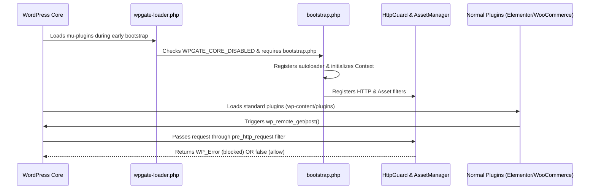

# WPGate Architecture & Lifecycle

[English](architecture.md) | [فارسی](../fa/architecture.md)


This document describes the internal structure, namespaces, and execution lifecycle of WPGate.

---

## 🏛️ Directory Structure

```text
wpgate-core/
├── bootstrap.php                   # Core entry point & autoloader
├── config/
│   ├── defaults.php                # Default configuration array
│   └── domain-presets.php          # Domestic Iranian gateway preset definitions
├── includes/
│   ├── Context.php                 # Environment detection (MU vs Theme) & asset URL resolvers
│   ├── Settings.php                # Memory-cached option manager & input sanitizer
│   ├── HttpGuard.php               # Outbound HTTP traffic firewall & domain matcher
│   ├── TimeoutGuard.php            # HTTP request timeout limiter
│   ├── TelemetryGuard.php          # WordPress.org telemetry mitigation
│   ├── UpdateGuard.php             # Core & plugin update interceptor
│   ├── GravatarGuard.php           # Gravatar HTML replacement filter
│   ├── AssetManager.php            # CDN script/style rewriter & fallback stubs
│   └── Logger.php                  # Sensitive-parameter-redacted diagnostics logger
├── admin/
│   ├── AdminController.php         # Administration menu, nonces, and dashboard widgets
│   └── views/
│       ├── settings-page.php       # Settings screen template
│       └── dashboard-widget.php    # Dashboard status widget template
└── assets/                         # Local fonts, webfonts, CSS/JS stubs, and avatar
```

---

## ⚙️ Namespaces & Class Responsibilities

All classes reside under the root namespace:
`WPGate\Core` (and sub-namespace `WPGate\Core\Admin`).

| Class | Responsibility | Lifecycle Hook |
|---|---|---|
| `Context` | Resolves absolute file paths and public URLs dynamically. | Static initialization |
| `Settings` | Caches `wp_options` in memory; provides sanitized defaults. | On-demand |
| `HttpGuard` | Preempts outbound HTTP requests matching firewall rules. | `pre_http_request` (10) |
| `TelemetryGuard` | Intercepts requests destined for `wordpress.org`. | `pre_http_request` (20) |
| `TimeoutGuard` | Clamps HTTP request timeout arguments. | `http_request_args` (20) |
| `AssetManager` | Replaces remote CDN script/style URLs with local assets. | `script_loader_src` / `style_loader_src` (20) |
| `GravatarGuard` | Replaces Gravatar markup with local/custom image. | `get_avatar` (10) |
| `UpdateGuard` | Intercepts update transient queries and version checks. | `pre_site_transient_update_*` |
| `Logger` | Records filtered events with credential masking. | Invoked by guards |
| `AdminController` | Renders dashboard screens and handles log clearing / resets. | `admin_menu`, `admin_init`, `wp_dashboard_setup` |

---

## ⏱️ Execution Sequence (MU-Plugin Mode)



---

## ⚡ Performance Optimization Principles

1. **Lazy Loading:** `AdminController` and view templates are only loaded when `is_admin() === true`. Front-end visitor requests never parse admin code.
2. **In-Memory Caching:** Settings are read once and stored in static memory, avoiding repetitive `get_option` queries across hundreds of asset checks per page.
3. **Zero Disk I/O:** No runtime filesystem writes or directory inspections occur during visitor requests.
4. **Log Deduplication:** Repeated identical blocked events within a 60-second window are discarded to protect database write IOPS.
